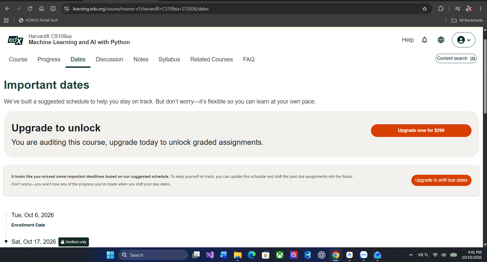

# BÁO CÁO KẾT QUẢ HOÀN THÀNH KHÓA HỌC MOOC
## ĐIỂM CỘNG (BONUS) MÔN CƠ SỞ TRÍ TUỆ NHÂN TẠO - TRƯỜNG ĐH KHOA HỌC TỰ NHIÊN (HCMUS)

---

### PHẦN 1: THÔNG TIN CHUNG
* **Họ và tên sinh viên:** [Điền họ và tên]
* **Mã số sinh viên:** [Điền MSSV]
* **Lớp:** [Điền tên lớp học]
* **Email sinh viên:** [Điền email trường @student.hcmus.edu.vn]
* **Tên khóa học:** HarvardX CS109xa: Machine Learning and AI with Python
* **Nền tảng:** edX (Harvard University)
* **Thời gian học:** Từ ngày [DD/MM/YYYY] đến ngày [DD/MM/YYYY]
* **Link kho lưu trữ bài tập & nhật ký:** [Điền link GitHub hoặc link thư mục Google Drive của bạn]

---

### PHẦN 2: MINH CHỨNG GHI DANH (ENROLLMENT EVIDENCE)

*(Chèn hình ảnh chụp màn hình email xác nhận đăng ký edX hoặc tab Dates)*

*Hình 1: Email xác nhận đăng ký khóa học từ edX (hiển thị rõ ngày nhận và địa chỉ email).*

*Hình 2: Mốc thời gian khóa học trên giao diện edX.*

---

### PHẦN 3: MINH CHỨNG TIẾN ĐỘ HỌC TẬP (LEARNING PROGRESS)

*(Chèn hình ảnh chụp tab Progress khi đã hoàn thành 100% các nội dung bài học)*

*Hình 3: Biểu đồ tiến độ hoàn thành khóa học trên edX (hiển thị URL và tài khoản chính chủ).*

---

### PHẦN 4: TÓM TẮT QUÁ TRÌNH HỌC TẬP & BÀI HỌC KINH NGHIỆM

*(Trích lọc và tổng hợp ngắn gọn từ các file trong thư mục `learning-logs/` do chính bạn viết)*

#### 1. Tổng quan các nội dung đã học:
* **Module 1 & 2 (Hồi quy tuyến tính & Đa biến):** Nắm vững hàm mất mát MSE, đạo hàm tính Gradient Descent, hiện tượng Overfitting và kỹ thuật điều chuẩn (Regularization: Ridge, Lasso).
* **Module 3 & 4 (Phân loại & Đánh giá mô hình):** Hiểu Logistic Regression, ma trận nhầm lẫn (Confusion Matrix), các chỉ số Precision, Recall, F1-score, ROC-AUC.
* **Module tiếp theo (...):** [Tóm tắt 1-2 dòng cho các module còn lại].

#### 2. Khó khăn kỹ thuật thực tế & Cách tự giải quyết (Reflection & Debugging):
* *Khó khăn 1:* [Mô tả ngắn 1 lỗi khi code bài lab, ví dụ: xử lý dữ liệu bị khuyết, chuẩn hóa đặc trưng, hoặc chỉnh learning rate].
* *Khó khăn 2:* [Mô tả cách bạn đã tìm hiểu và khắc phục thành công].

#### 3. Mối liên hệ với môn Cơ sở AI (HCMUS):
* [Ghi 3–4 câu liên hệ: Ví dụ thuật toán Gradient Descent trong khóa học là một dạng tối ưu hóa cục bộ (Local Search/Optimization) đã được học trong môn Cơ sở AI; bài toán hồi quy/phân loại mở rộng cho phần Học có giám sát (Supervised Learning)...]

---

### PHẦN 5: KẾT LUẬN & CAM KẾT LIÊM CHÍNH HỌC THUẬT
Em xin cam đoan toàn bộ bài tập thực hành, nhật ký học tập và báo cáo này đều do chính em tự học và thực hiện, tuân thủ đúng quy định về liêm chính học thuật của môn học.

*TP. Hồ Chí Minh, ngày ... tháng ... năm 202...*  
**Người làm báo cáo**  
*(Ký và ghi rõ họ tên)*
